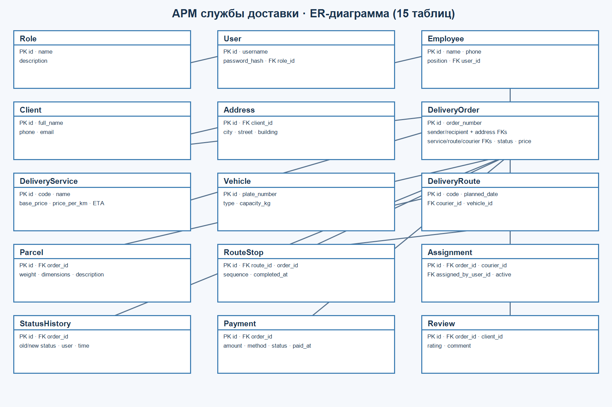

# Вариант 13 — АРМ службы доставки товаров по городу

**Курс:** Прикладное программное обеспечение информационных систем (2026 г.)  
**Автор:** укажите ФИО и группу перед сдачей.

Система автоматизирует прием и обработку городских доставок. Оператор регистрирует отправителя и получателя, их адреса, выбирает тариф, рассчитывает стоимость и назначает курьера или маршрут. Курьер видит назначенные ему отправления и обновляет статусы. История изменений, оплаты и отчеты доступны руководителю.

## Роли

- **Администратор** — полный доступ, управление пользователями и тарифами.
- **Менеджер** — клиенты, адреса, услуги, заказы, маршруты, назначения, статусы, оплаты и отчеты.
- **Курьер** — просмотр назначенных ему заказов и обновление статуса доставки.

Демо-учетные записи после заполнения базы: `admin / Admin123!`, `manager / Manager123!`, `courier1 / Courier1!`. Перед реальным развертыванием смените пароли и задайте свой `TOKEN_SECRET`.

## Архитектура данных и диаграммы



В БД 15 связанных таблиц: `Role`, `User`, `Client`, `Employee`, `Vehicle`, `DeliveryService`, `Address`, `DeliveryRoute`, `DeliveryOrder`, `Parcel`, `RouteStop`, `Assignment`, `StatusHistory`, `Payment`, `Review`.

- Клиенты имеют адреса; у заказа есть отправитель, получатель и два адреса.
- Услуга определяет базовую ставку, стоимость километра и срок.
- Заказ связан с услугой, назначенным курьером, маршрутом, посылками, платежами и историей статусов.
- Маршрут содержит упорядоченные остановки, а назначение сохраняет курьера и пользователя, который его назначил.

Дополнительные схемы: [Use Case](docs/use-case.svg) · [Activity: обработка заказа](docs/activity.svg).

## Расчет цены и статусы

`Стоимость = max(0, базовый тариф + цена за км × расстояние + вес × 100 − скидка)`.

Допустимые переходы статуса: `new → confirmed → assigned → in_transit → delivered → paid → closed`. При необходимости заказ в пути можно перевести в `delayed`, затем вернуть в `in_transit`; до назначения его можно отменить. Все переходы записываются в `StatusHistory`.

## Технологический стек

Python 3.12 · FastAPI · SQLModel · SQLite · Streamlit · Docker Compose · Pytest.

## Запуск локально

Нужны Python 3.12+ и pip. Для локального запуска можно задать ключ токена в PowerShell перед стартом API: `$env:TOKEN_SECRET='длинный-случайный-ключ'`.

```powershell
python -m venv .venv
.venv\Scripts\Activate.ps1
pip install -r requirements.txt
python seed.py
uvicorn app.main:app --reload
```

Во втором терминале запустите интерфейс: `streamlit run app/frontend/ui.py`.

- Streamlit: http://localhost:8501
- REST API: http://localhost:8000
- Swagger UI: http://localhost:8000/docs

При локальном запуске задайте `TOKEN_SECRET` переменной среды для защищенных токенов. Без нее используется демонстрационный ключ.

## Запуск Docker Compose

Требуется Docker Desktop с Compose.

```bash
docker compose up --build
```

API создает таблицы и наполняет демонстрационную базу при первом запуске. SQLite хранится в volume `delivery-data`. Чтобы остановить сервисы, используйте `docker compose down`.

## Демо-данные

`python seed.py` создает 3 роли, 7 учетных записей, 20 клиентов, 40 адресов, 10 тарифов, 5 курьеров, 5 транспортных средств, 5 маршрутов и 30 заказов с историей и оплатами. Заполнение идемпотентно: если роли уже существуют, seed пропускается.

## Основные API-маршруты

- `POST /auth/login`, `GET /auth/me`, `POST /users`
- `GET/POST /clients`, `GET/POST /clients/{id}/addresses`, `GET /clients/{id}/orders`
- `GET/POST /users`, `GET /roles` (только администратор)
- `GET/POST /services`, `PATCH /services/{id}`
- `GET/POST /employees`, `GET/POST /vehicles` (creation is administrator-only)
- `GET/POST /orders`, `GET /orders/{id}`, `GET /orders/{id}/history`
- `GET/POST /orders/{id}/parcels`, `POST /orders/{id}/reviews`
- `POST /orders/{id}/assign`, `PATCH /orders/{id}/status`, `POST /orders/{id}/payments`
- `GET/POST /routes`, `POST /routes/{id}/stops`
- Отчеты: `/reports/summary`, `/reports/orders-by-month`, `/reports/by-service`, `/reports/by-courier`, `/reports/top-clients`, `/reports/overdue`.

Список заказов поддерживает фильтры по номеру, имени/телефону клиента, курьеру, услуге, статусу, цене и дате.

## Автоматические тесты

```bash
pytest
```

Покрыты требование авторизации, создание заказа и расчет тарифа, история статусов, поиск и проверка перехода статуса.

## Публикация на GitHub

Создайте публичный репозиторий, например `applied-is-project-2026`, затем подключите его:

```bash
git remote add origin https://github.com/<логин>/applied-is-project-2026.git
git add .
git commit -m "feat: build city delivery information system"
git branch -M main
git push -u origin main
```

## Контрольные вопросы

1. `venv` изолирует версии библиотек проекта. Без нее зависимости разных приложений могут конфликтовать в системном Python.
2. `.gitignore` исключает виртуальные среды и локальные файлы. Пароли и ключи нельзя отправлять в Git, потому что они предоставляют доступ к системам и данным.
3. ИИ-инструменты помогают создавать шаблоны и анализировать код, но сгенерированные решения нужно проверять на ошибки, ограничения доступа и корректность бизнес-правил.
4. Ветка Git изолирует изменения. Разработка в отдельных ветках и ревью защищают стабильную `main` от непроверенных правок.
5. `git commit` сохраняет изменения локально; `git push` отправляет созданные коммиты в удаленный репозиторий.
